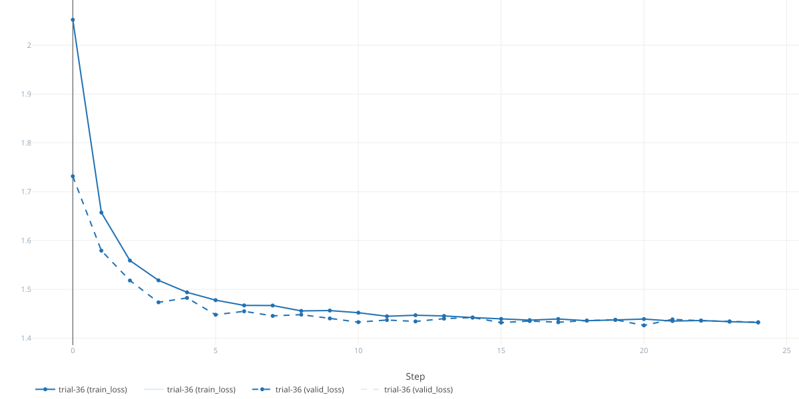
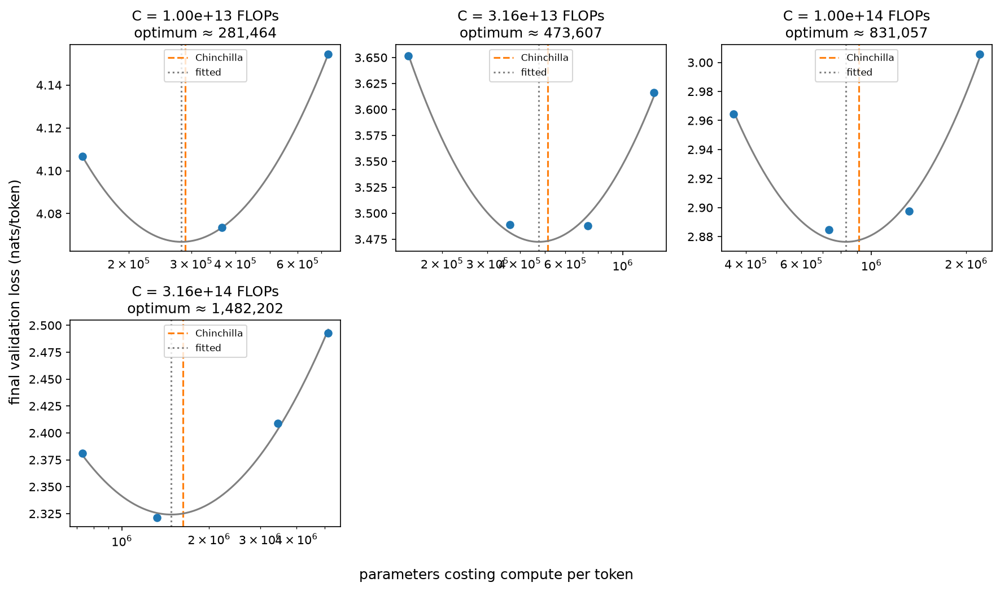
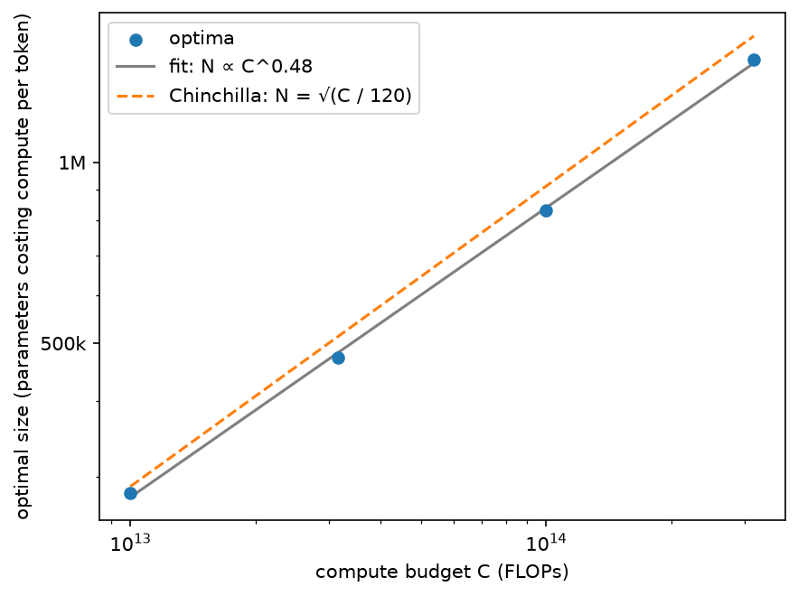

# Transformer

A GPT-1-style decoder-only transformer built from scratch in PyTorch, benchmarked
against a language whose **best possible loss is known exactly**.

When you train a language model on real text, you never know how good "good" is:
a validation loss of 1.9 might be excellent or terrible. This project avoids that
by first training on an artificial language generated from a probabilistic
grammar. For such a language the entropy per token can be computed in closed
form, which gives a hard floor for the cross-entropy loss. The model is correct
when its validation loss approaches that floor and never beats it.

## The artificial language

The language is a probabilistic context-free grammar (PCFG) with number agreement
and nested relative clauses:

```
S       -> NP_sg VP_sg Dot [0.5] | NP_pl VP_pl Dot [0.5]
NP_sg   -> Det_sg Nom_sg [0.8] | Det_sg Nom_sg Rel [0.2]
Rel     -> "that" NP_sg Vt_sg [0.5] | "that" NP_pl Vt_pl [0.5]
Nom_sg  -> Adj Nom_sg [0.3] | N_sg [0.7]
...
```

Sampled text looks like this:

```
the cat sees . a cat that this cat chases sees some dogs .
the dog sees a dog that some small dogs that those dogs that these small cats see chase see .
```

Getting the verbs right in the second sentence requires tracking agreement across
arbitrarily deep embeddings, so a model can only reach the floor if it has
genuinely learned the grammar.

The grammar lives in a plain text file and is loaded with NLTK. Every word is a
token, so no tokenizer is needed. A torch `Dataset` samples sentences, joins
them into a continuous stream and cuts it into fixed-length windows.
Sampling is deterministic per index and seed, so train, validation and test sets
are independent by construction.

## The entropy floor

For a nonterminal `A` with rules `r`, the entropy of everything `A` generates
satisfies

```
H(A) = −Σ_r p(r) log p(r)  +  Σ_r p(r) Σ_{B ∈ rhs(r)} H(B)
```

and the expected length `L(A)` has the same form. Both are linear systems,
`(I − M) x = c`, where `M[A, B]` is the expected number of `B`s produced by one
expansion of `A`. Solving them gives the per-token entropy `H(S) / L(S)`.
The solver also checks the grammar's consistency (spectral radius of `M` < 1).

The result is cross-checked by an independent Monte Carlo estimator. The sampler
accumulates each sentence's log-probability while it samples, and the tests
confirm that it matches NLTK's Viterbi parse probability.

| grammar | analytic | Monte Carlo (80k sentences) |
|---|---|---|
| main language | **1.4046 nats/token** | 1.4051 |
| coin flip `S → a \| b` | ln 2 | ln 2 (exact) |

This equals the entropy of the text only if the grammar is unambiguous, and a
test parses sampled sentences to verify that each has exactly one parse.

One subtlety: the first token of each training window is only ever an input,
never a target, so the achievable loss per window is slightly *below*
`H(S) / L(S)`. The tests account for this correction.

## The model

A GPT-1-style decoder-only transformer, written from the individual pieces:

- token embedding plus sinusoidal positional encoding, stored as a buffer
  (GPT-1 itself learns its position embeddings);
- masked multi-head self-attention with a causal mask;
- a position-wise feed-forward network with GELU;
- post-LayerNorm residual blocks;
- a linear output layer producing logits for `CrossEntropyLoss`.

With `gpt_2_like=True` it becomes a GPT-2-style decoder: pre-LayerNorm blocks, a
final LayerNorm before the output layer, and the projections that write into the
residual stream initialized smaller by `1/√(2 · n_layers)`, so the residual stream
does not grow with depth.

The training loop trains for a budget of tokens (rather than epochs), passing over
the data as often as needed, and is a generator that yields
`(train_loss, valid_loss)` at a fixed interval of tokens. The caller decides when
to stop, log or plot. For TinyStories it uses the GPT-3 recipe: AdamW
(β₂ = 0.95, weight decay 0.1 on weight matrices only), a linear warmup followed by
cosine decay to 10% of the peak learning rate, and gradient clipping at norm 1.0.

## What the tests certify

Beyond unit-level checks on shapes, determinism and batch independence, the model
is tested end to end against languages with known floors:

| test | language | what it proves |
|---|---|---|
| `test_can_reach_0_loss_if_possible` | `test1 test2 test3 test4 …` (entropy 0) | the model and training loop can learn: gradients flow and the output is wired correctly |
| `test_can_reach_theoretical_best_loss` | `a x b \| c x d` | the validation loss approaches the analytic floor and never goes below it |

The second test is the important one. Predicting `b` versus `d` after `x`
requires attending two positions back, so the test **fails when attention is
disabled**. The "never below the floor" check catches information leaks such as a
broken causal mask. Validation uses a separately seeded dataset, so the model
cannot pass by memorising.

The estimator tests pin the analytic solver against grammars with exact answers,
and compare it with the Monte Carlo estimate on the main language.

## Experiment: how close does the model get?

The tests show that the model *can* reach the floor on small languages. The
experiment in [`experiments/simple_language`](experiments/simple_language/train.py)
measures how close it gets on the main language, and with which architecture.

### Setup

- **Search:** [Optuna](https://optuna.org/) with a TPE sampler over the number of
  layers, model width, heads, dropout and learning rate.
- **Pruning:** Hyperband stops unpromising trials early. It can be switched to a
  median pruner or disabled with `--pruner`.
- **Tracking:** every trial is an [MLflow](https://mlflow.org/) run nested under
  one parent run per study. Each run logs its hyperparameters and its per-epoch
  train and validation loss. The best trial is tagged `best=true`, and the parent
  run records its id.
- **Data:** train, validation and test sets are sampled from the grammar with
  different seeds, so they are independent. The best model is checkpointed during
  the search and evaluated **once** on the test set, which played no part in
  selecting it.

### Result

The best of 70 trials (48 of them pruned), trained for 25 epochs:

| | |
|---|---|
| architecture | 4 layers, width 64, 2 heads |
| learning rate / dropout | 2.6e-3 / 0.10 |
| validation loss | 1.4327 |
| **test loss** | **1.4368 nats/token** |
| entropy floor | 1.4046 nats/token |
| gap | 0.032 nats/token (perplexity 4.21 vs 4.07) |



The test loss is within about 2% of the theoretical optimum. Measured against the
per-window floor, which is lower (roughly 1.39, see above), the gap is about
0.04 nats/token. The test loss is only slightly above the validation loss, which
shows that selecting the best of 70 trials on the validation set introduced
little optimism.

Optuna's hyperparameter importance ranks the **learning rate** and **dropout** as
the most important parameters, ahead of the architecture itself.

### Generated text

As a smoke test, the best model generates 3,000 tokens after a one-sentence
prompt, and each generated sentence is parsed with the grammar: **369 of 412
(89.6%) are grammatical**. Simple sentences are flawless. Almost all errors are
in nested relative clauses, where the model has to keep track of how many verbs
are still owed and which subject each agrees with:

```
ok   some cats that a dog sees see some dogs .
BAD  a dog that these dogs chase eat .
BAD  this cat that these dogs that the cat sees sees eat .
```

### Running it

```bash
# 1. start an MLflow tracking server (UI at http://localhost:8888)
poetry run mlflow server --port 8888

# 2. run the study: trials, epochs and pruner are configurable
poetry run python -m experiments.simple_language.train \
    --language-spec tests/language_specs/language_1.txt \
    --n-trials 50 --n-epochs 25 --pruner hyperband

# 3. optional: Optuna's dashboard for hyperparameter importance and slice plots
poetry run optuna-dashboard sqlite:///experiments/simple_language/optuna.db \
    --port 8081 --server wsgiref

# 4. generate text with the best model and check it against the grammar
poetry run python -m experiments.simple_language.generate
```

The script prints the best trial and its test loss when it finishes. The Optuna
study is stored in `experiments/simple_language/optuna.db` and resumes where it
left off when you run it again.

The dashboard needs `--server wsgiref`. With the default server it runs on
gunicorn, whose forked workers inherit the SQLite connection, which then fails
with `disk I/O error`.

## Tokenizer

The next step is real text, so the project has a byte-level BPE tokenizer
written from scratch in [`src/bpe`](src/bpe/bpe.py).

- **Pre-tokenization:** a regex splits text into words, punctuation and
  whitespace, keeping a leading space attached to the following word (`" cat"`),
  so that merges never cross word boundaries.
- **Training:** works on word counts rather than raw text. The corpus is streamed
  once to count words; each merge then joins the most frequent adjacent pair of
  ids, weighted by word frequency.
- **Encoding:** within each word, applies the earliest-learned merge first, so
  text is split exactly as it was during training.
- **Byte level:** ids 0–255 are raw bytes, so any text can be encoded, with no
  unknown tokens. Decoding joins the bytes before decoding UTF-8, so characters
  that span several tokens survive the round trip.
- **Storage:** merges are saved as an ordered JSON list of pairs, with no pickle
  involved.

### On TinyStories

With a vocabulary of 4,096 tokens, trained on the first 100,000 stories in about
three minutes on a laptop, the first merges are the building blocks of English
(`" the"`, `" and"`, `" was"`), and the last ones are words like `" tornado"`
and `" napkin"`. Typical story text comes out at one token per word:

```
Once| upon| a| time|,| there| was| a| little| girl| named| Lily|.
```

while text from outside the domain falls back to smaller pieces, without losing
anything:

```
The| qu|ant|um| ch|rom|o|dy|nam|ic|s| l|ec|ture| was| post|p|on|ed|.
```

To train it (the merges are saved to `data/tinystories/merges.json`):

```bash
poetry run python -m experiments.train_tokenizer --vocab-size 4096 --max-documents 100000
```

### Data pipeline

Training reads tokens, not text. Each split is encoded once into a flat file of
`uint16` token ids, with a dedicated end-of-text token (id 4096, one past the
tokenizer's vocabulary) between stories. The tokenizer never sees the
`<|endoftext|>` marker itself: it only splits the stories.

[`TinyStoriesDataset`](src/data/tiny_stories.py) opens that file as a NumPy
memory map, so the corpus never has to fit in memory, and serves consecutive,
non-overlapping windows of `context_length + 1` tokens. Each item is an
`Example(inputs, targets)`, where the targets are the inputs shifted by one
token. With the causal mask, one window therefore trains `context_length`
next-token predictions at once.

The token file is written to a temporary file that is renamed only when encoding
finishes, so an interrupted run never leaves a partial file behind. Encoding
caches the ids of every pre-tokenized piece, since pieces like `" the"` repeat
millions of times.

To encode the train and validation sets into `data/tinystories/train.bin` and
`valid.bin`:

```bash
poetry run python -m experiments.encode_data
```

## Scaling laws on TinyStories

To choose the size of the TinyStories model, the project follows Chinchilla's
approach 2 (IsoFLOP profiles): for a fixed compute budget `C`, train models of
different sizes `N`, each on `D = C / 6N` tokens, and find the size with the
lowest loss. The optimal sizes of several budgets then give a scaling law
`N_opt ∝ C^a`, which predicts the right model for a larger budget.

### One run

[`isoflops_run.py`](experiments/tinystories/isoflops_run.py) trains one model. A
run is defined by just two numbers, the budget and the depth; everything else is
held fixed, so that differences in loss can only come from `N` and `D`:

- the shape: width grows with depth at a fixed ratio (`d_model = 32 × n_layers`,
  one head per 32 dimensions), so every model has a sensible shape. Kaplan et al.
  found the loss to depend mainly on the parameter count and only weakly on the
  shape, except at extremes such as very deep and narrow models;
- the training recipe, with the cosine schedule spanning exactly the run's `D`
  tokens, as Chinchilla requires;
- no dropout: each run sees every token at most once, so there is nothing to
  overfit.

Each run is an MLflow run tagged with its sweep, logging its loss curves, model
size, `D`, FLOPs and throughput. Only the final validation loss enters the
analysis: points from the middle of a run are not valid for a smaller budget,
because their learning-rate schedule has not finished.

### Counting parameters

How `N` is counted matters a lot at this scale, because the output layer
(`d_model × 4,097`) is large compared to small models:

| convention | counts | used by |
|---|---|---|
| non-embedding (`n_params`) | the transformer blocks | Kaplan et al. |
| total | everything, embeddings included | Chinchilla |
| compute (`compute_params`) | the blocks plus the output layer | this project |

The compute convention counts the parameters that take part in a matrix
multiplication on every token (the input embedding is only a lookup), so a token
costs about `6 × compute_params` FLOPs. `D` is derived from it. Leaving the
output layer out would hand the smallest models, which see the most tokens, up to
3.6 times more real compute than their budget.

### A sweep and its profiles

[`isoflops_sweep.py`](experiments/tinystories/isoflops_sweep.py) plans and runs a
whole sweep: for each budget, a few depths whose sizes spread from a third to
three times the size Chinchilla's rule of thumb predicts (about 20 tokens per
parameter, so `N ≈ √(C / 120)`). It skips runs the sweep has already finished, so
it can be stopped and restarted.
[`plot_parabolas.py`](experiments/tinystories/plot_parabolas.py) fetches a sweep
from MLflow, fits a parabola in log size through the final losses of each budget,
and fits the scaling law through the minima of those parabolas.

```bash
poetry run python -m experiments.tinystories.isoflops_sweep \
    --budget 1e13 --budget 3.16e13 --budget 1e14 --budget 3.16e14 --budget 1e15 \
    --sweep final
poetry run python -m experiments.tinystories.plot_parabolas --sweep final
```

### Results

The first four budgets (the largest is still running) each give a clear profile,
with the minimum bracketed by smaller and larger models:



| budget | optimal size | `√(C / 120)` | tokens | tokens per parameter | loss |
|---|---|---|---|---|---|
| 10¹³ | 281k | 289k | 5.9M | 21.0 | 4.07 |
| 3.16 × 10¹³ | 474k | 513k | 11.1M | 23.5 | 3.47 |
| 10¹⁴ | 831k | 913k | 20.1M | 24.1 | 2.88 |
| 3.16 × 10¹⁴ | 1.48M | 1.62M | 35.5M | 24.0 | 2.32 |

The minima lie on a straight line in log-log space, the scaling law
`N_opt = 0.151 · C^0.48`, so that `D_opt ∝ C^0.52`:



With `N` counted as compute parameters, consistently with how `C` and `D` are
computed, this is close to Chinchilla: an exponent near 0.5, so model size and
data should grow about equally with compute, and a stable 21 to 24 tokens per
parameter against Chinchilla's rule of thumb of about 20. Counted as non-embedding
parameters, the same runs grow as about `C^0.84`, on the steep side like Kaplan's
0.73. Much of the difference between the two papers' scaling laws comes from
exactly this choice of whether to count embedding parameters, which matters most
for small models (Pearce and Song, "Reconciling Kaplan and Chinchilla Scaling
Laws", 2024). With four budgets spanning one and a half decades of compute, the
exponents are still preliminary.

On an Apple-silicon laptop (MPS), small models train at about 1.5 × 10¹¹ FLOPs
per second, so a run takes about 10 minutes at `C = 10¹⁴` and one to two hours at
`C = 10¹⁵`.

## Layout

```
src/
  bpe/          byte-level BPE tokenizer
  data/         grammar sampling and windowed datasets for both languages
  estimators/   analytic (linear system) and Monte Carlo entropy estimators
  model/        embedding, attention, feed-forward, block, decoder
  experiment/   training loop, optimizer and learning-rate schedule
experiments/
  simple_language/    hyperparameter search on the artificial language
  tinystories/        IsoFLOPs runs, sweeps and plots on TinyStories
  download_data.py    download TinyStories (train and validation)
  train_tokenizer.py  train the BPE tokenizer on TinyStories
  encode_data.py      encode both splits into token files
tests/
  language_specs/   the grammars used in tests
  unit/             tokenizer building blocks
  integration/      data, estimator, model and tokenizer tests
```

## Getting started

Requires Python 3.13 and [Poetry](https://python-poetry.org/).

```bash
poetry install
poetry run pytest                  # full test suite, ~10 s on a laptop CPU
tox                                # tests, flake8, black/isort, mypy
```

To download [TinyStories](https://huggingface.co/datasets/roneneldan/TinyStories)
(the GPT-4 version: about 2 GB of training data and a 22 MB validation set) into
`data/tinystories/`:

```bash
poetry run python -m experiments.download_data
```

## Use of AI

This project was built with the help of an AI coding assistant (Claude, used
through Claude Code). Because the project is partly a learning exercise, I wrote
the core parts myself and used the assistant mostly as a reviewer and tutor.

**My own work:**
- the project idea: benchmarking a transformer against the exact entropy of a
  probabilistic grammar
- the grammar
- the model components, adapted from a transformer I implemented earlier
- the Monte Carlo estimator
- the overall design of the data pipeline, tests and experiment
- the codebase architecture, design choices and interfaces
- the testing infrastructure (fixtures) and part of the tests
- the choice of tools

**With help from the assistant:**
- **Code review.** I ported the model components from an implementation I wrote
  a few years ago and asked the assistant to review them for latent bugs. The
  review surfaced several silent ones, such as unregistered submodules and a
  causal mask sized by the batch instead of the sequence. They are fixed, and
  the tests now guard against them.
- **Explanations** of concepts I was refreshing, such as the analytic entropy
  of a PCFG, `register_buffer` and pruning strategies in hyperparameter search.
- **Code.** I wrote the first versions of the training loop, the analytic
  estimator and the experiment script, including the Optuna search and MLflow
  tracking. The assistant refactored them and implemented parts I specified,
  such as pruning, tagging the best run, the final test evaluation and the
  linear-system solve. It also wrote some supporting code (the sampler that
  tracks log-probabilities, the vocabulary and collate functions) and several
  tests.
- **This README,** which it drafted and I edited.

The assistant also pointed out that the achievable loss per training window is
slightly below the per-token entropy, and that correction is now part of the
tests.

All results reported here come from running the code in this repository. I
reviewed the code and the explanations above and can account for them.
